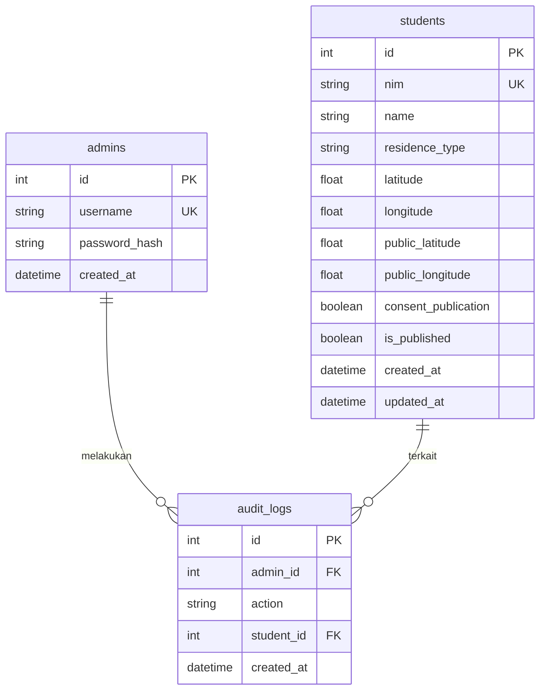

# Perancangan Basis Data & Model Spasial — GeoResidence

Aplikasi GeoResidence menggunakan **SQLite** (`georesidence.db`) sebagai penyimpanan relasional lokal yang ringan, independen (*zero-dependency*), dan tangguh (*ACID compliant*).

---

## 1. Diagram Relasi Entitas (ERD)

---

## 2. Struktur Tabel & Spesifikasi Kolom

### Tabel: `students`
Menyimpan informasi residensial mahasiswa Teknik Geomatika ITERA.

| Nama Kolom | Tipe Data | Keterangan |
| :--- | :--- | :--- |
| `id` | `INTEGER` | Primary Key, Auto Increment, Indexed. |
| `nim` | `VARCHAR(32)` | Nomor Induk Mahasiswa. Unik, Tidak boleh kosong, Indexed. |
| `name` | `VARCHAR(128)` | Nama lengkap mahasiswa, Indexed. |
| `residence_type` | `VARCHAR(32)` | Kategori tempat tinggal: `'Rumah'`, `'Kost'`, atau `'Kontrakan'`. |
| `latitude` | `FLOAT` | Garis lintang presisi (asli) mahasiswa (rentang: -90 s/d 90). **Rahasia & Hanya Admin**. |
| `longitude` | `FLOAT` | Garis bujur presisi (asli) mahasiswa (rentang: -180 s/d 180). **Rahasia & Hanya Admin**. |
| `public_latitude` | `FLOAT` | Garis lintang hasil generalisasi spasial (~120–280 m). Ditampilkan ke publik. |
| `public_longitude` | `FLOAT` | Garis bujur hasil generalisasi spasial (~120–280 m). Ditampilkan ke publik. |
| `consent_publication` | `BOOLEAN` | Persetujuan mahasiswa untuk mempublikasikan lokasinya secara umum (default: `true`). |
| `is_published` | `BOOLEAN` | Status aktivasi publikasi oleh administrator (default: `true`). |
| `created_at` | `DATETIME` | Waktu rekaman dibuat (UTC). |
| `updated_at` | `DATETIME` | Waktu pembaruan terakhir rekaman (UTC). |

---

### Tabel: `admins`
Menyimpan akun pengguna administrator terverifikasi untuk pengelolaan data.

| Nama Kolom | Tipe Data | Keterangan |
| :--- | :--- | :--- |
| `id` | `INTEGER` | Primary Key, Auto Increment, Indexed. |
| `username` | `VARCHAR(64)` | Nama pengguna administrator. Unik, Indexed. |
| `password_hash` | `VARCHAR(255)` | Hash kata sandi menggunakan algoritma **Bcrypt** (12 *salt rounds*). |
| `created_at` | `DATETIME` | Waktu akun dibuat (UTC). |

---

### Tabel: `audit_logs`
Mencatat histori aktivitas operasional penting oleh administrator untuk akuntabilitas.

| Nama Kolom | Tipe Data | Keterangan |
| :--- | :--- | :--- |
| `id` | `INTEGER` | Primary Key, Auto Increment. |
| `admin_id` | `INTEGER` | Foreign Key merujuk ke `admins.id`. |
| `action` | `VARCHAR(255)` | Deskripsi aksi (cth: *"Menambahkan mahasiswa: Budi (121110001)"*, *"Bulk Import: 137 imported"*). |
| `student_id` | `INTEGER` | Foreign Key opsional merujuk ke `students.id` (`ON DELETE SET NULL`). |
| `created_at` | `DATETIME` | Waktu pencatatan log (UTC). |

---

## 3. Algoritma Generalisasi Privasi Spasial (*Controlled Spatial Displacement*)

Untuk melindungi keselamatan dan privasi residensial mahasiswa dari ancaman *doxing* atau pelacakan pintu hunian asli, GeoResidence menerapkan algoritma pergeseran annular:

$$R \in [120\text{ m}, 280\text{ m}]$$
$$\theta \sim \text{Hash}(\text{NIM}) \pmod{2\pi}$$

1. **Seed Deterministik:** Sudut pergeseran ($\theta$) dan rasio jarak ($r$) diturunkan dari digest SHA-256 dari NIM mahasiswa. Hal ini memastikan lokasi publik tetap konsisten (*stable marker*) ketika data disaring ulang tanpa melompat-lompat, namun tidak dapat dibalikkan secara matematis ke koordinat pintu rumah.
2. **Konversi Geodesi:** Jarak meter dikonversi menjadi derajat lintang dan bujur berdasarkan kelengkungan lokal bumi:
   $$\Delta\text{lat} = \frac{r \cdot \cos\theta}{111320.0}$$
   $$\Delta\text{lon} = \frac{r \cdot \sin\theta}{111320.0 \cdot \cos(\text{lat}_{\text{rad}})}$$
3. **Isolasi API Publik:** Titik `latitude` dan `longitude` presisi tidak pernah diikutsertakan dalam model Pydantic `StudentPublic`. Endpoint publik hanya mengirimkan `public_latitude` dan `public_longitude`.
